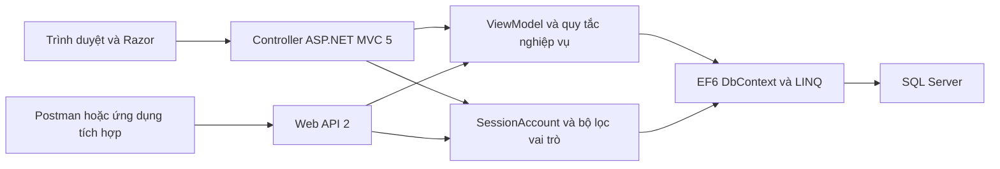

# Kiến trúc ứng dụng

`Views/Shared/_Layout.cshtml` sở hữu Sidebar, thông báo TempData và tài nguyên CSS/JS chung. Module giữ ModelState và điều hướng nghiệp vụ. `AccountInputs` giới hạn binding. `PasswordHasher` xử lý dẫn xuất khóa và xác minh. `SessionAccount` đối chiếu hash và trạng thái quyền cho mỗi phiên.

`EquipmentPolicy` chia sẻ điều kiện thay đổi tài sản giữa MVC và Web API. `MedicalEquipmentContext.LockAsset` bảo vệ các workflow cùng sửa vị trí hoặc trạng thái. Dashboard dùng LINQ và Chart.js cục bộ. [Hướng dẫn đọc mã](SOURCE_CODE_GUIDE.md)
