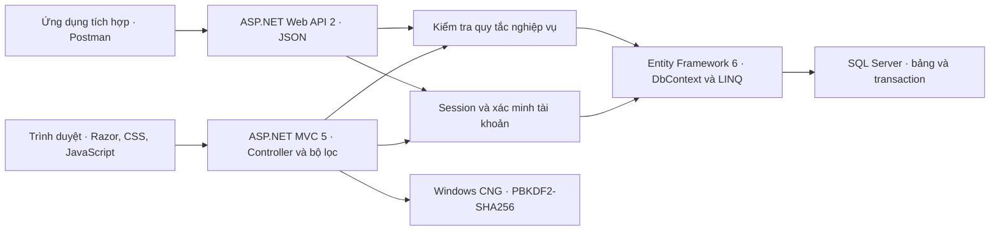

# Hướng dẫn đọc và bảo trì mã nguồn

## Kiến trúc

| Vị trí | Vai trò |
|---|---|
| `App_Start/`, `Global.asax.cs` | Đăng ký routing MVC, Web API, bundle và bộ lọc. Cấp Session chỉ đọc cho Web API và tắt tự khởi tạo EF. |
| `Controllers/`, `Api/` | Nhận tham số, kiểm quyền, gọi EF6 và trả Razor View hoặc JSON. |
| `Data/`, `Models/` | Ánh xạ bảng, cột, quan hệ và truy vấn lịch mới nhất. |
| `Filters/`, `Helpers/` | Tái xác nhận quyền, PBKDF2, validation tài sản, nhận diện lỗi khóa SQL và tạo mã QR/Barcode. |
| `ViewModels/`, `Views/` | Chỉ nhận và hiển thị trường cần dùng. Razor xuất HTML và biểu mẫu có token. |
| `Content/`, `Scripts/` | Giao diện, trạng thái gửi biểu mẫu và biểu đồ cục bộ. |
| `Database/`, `Docs/` | Script SQL, hướng dẫn, ràng buộc phát hành và bằng chứng QA. |

Các đường dẫn mã nguồn trong bảng được tính từ thư mục `MedicalEquipmentManagement/`.

## Controller

| Controller | Điểm vào và trách nhiệm |
|---|---|
| Account | `Login` xác thực qua EF và CNG, `Logout` nhận POST, `ChangePassword` xác minh mật khẩu hiện tại rồi cập nhật có điều kiện. |
| UserAdmin | `Index`, `Edit`, `ResetPassword` giúp ADMIN quản lý danh tính và quyền. |
| Category, Supplier | CRUD danh mục và nhà cung cấp có kiểm tra khóa tham chiếu. |
| EquipmentModel | CRUD dòng thiết bị, liên kết danh mục và hãng sản xuất; form dùng ViewModel. |
| Equipment | Tra cứu theo mã, Serial, khoa, trạng thái. Tạo và sửa có validation, xóa mềm, nhập Excel, QR và Barcode. |
| Department | ADMIN quản lý danh mục khoa/phòng; xóa kiểm tra thiết bị và lịch sử kho. |
| Inventory | Danh sách vị trí, tạo phiếu điều chuyển và xem lịch sử kho. |
| WorkOrder | STAFF gửi báo hỏng, ADMIN/MANAGER phân công, kỹ sư được giao cập nhật tiến độ và nghiệm thu. |
| Maintenance | Xem lịch sử và cảnh báo bảo trì. ADMIN/ENGINEER ghi kết quả, chi phí, người thực hiện và liên kết phiếu. |
| Calibration | Xem nhật ký và hạn hiệu chuẩn. ADMIN/ENGINEER nhập kết quả và chứng nhận. |
| Home, Error | Home phân biệt khách và người đăng nhập, tổng hợp Dashboard bằng LINQ. Error trả trang lỗi thân thiện. |
| EquipmentApi | `GET /api/equipments`, `GET/PUT/DELETE /api/equipments/{id}` và `POST /api/equipments`. Phương thức ghi yêu cầu vai trò và token. |

## Model và ViewModel

| Loại | Thành phần |
|---|---|
| Tài khoản | `Role` nhận diện quyền theo mã. `User` giữ danh tính, hash và trạng thái. `UserAdminInput`, `NewPasswordInput`, `ChangePasswordInput` giới hạn trường có thể bind. |
| Danh mục | `Department` lưu khoa/phòng. `Supplier` lưu đối tác. `EquipmentCategory` phân loại. `EquipmentModel` mô tả dòng máy. `KeywordSearchViewModel<T>` gom từ khóa và dữ liệu. `EquipmentModelFormViewModel` vận chuyển trường sửa và lựa chọn. `EquipmentModelIndexViewModel` vận chuyển bộ lọc và danh sách. |
| Tài sản | `EquipmentAsset` đại diện một thiết bị vật lý. `AssetStatus` và `SupplierTypeConst` chuẩn hóa mã dùng lại. `EquipmentAssetViewModel` nhận trường CRUD. `EquipmentAssetIndexViewModel` giữ bộ lọc/sắp xếp/trang. `EquipmentImportViewModel` và `EquipmentImportRowResult` báo lỗi file theo dòng. |
| Vòng đời | `AssetTransfer` lưu khoa nguồn, đích và người yêu cầu. `InventoryTransaction` lưu giao dịch kho. `WorkOrder` lưu người báo, người được giao và kết quả. `MaintenanceRecord` lưu kỹ thuật viên, lịch và chi phí. `CalibrationLog` lưu hiệu chuẩn và chứng nhận. |
| Dữ liệu nền | `Contract` chứa hợp đồng. `SparePart` mô tả vật tư. `UsageLog` lưu số liệu sử dụng. Chúng hỗ trợ schema hiện có, chưa có đầy đủ giao diện độc lập trên nhánh này. |
| Tổng quan | `DashboardViewModel` gom chỉ số, bộ lọc, cảnh báo và số liệu chi phí. `DashboardCount` và `DashboardAlert` cung cấp các hàng dữ liệu cho Razor và Chart.js. |

## Quan hệ dữ liệu

- `Roles 1–n Users`; `EquipmentCategories 1–n EquipmentModels`; `Suppliers 1–n EquipmentModels` qua hãng sản xuất.
- `EquipmentModels 1–n EquipmentAssets`; `Departments 1–n EquipmentAssets` với khoa hiện tại nullable; khóa hợp đồng được giữ ở SQL.
- Mỗi tài sản có nhiều `AssetTransfers`, `WorkOrders`, `MaintenanceRecords`, `CalibrationLogs`, `UsageLogs` và giao dịch kho. Phiếu điều chuyển giữ cả khoa nguồn lẫn khoa đích.
- `WorkOrders.ReportedBy` trỏ đến `Users.UserId`. `AssignedToUserId` và `ResolvedByUserId` trỏ đến tài khoản qua các khóa riêng, có thể trống. `MaintenanceRecords.TicketId` nối phiếu sửa chữa khi có.
- `Maintenance_SpareParts` là bảng nối giữa bản ghi bảo trì và linh kiện. Không tự suy đoán khoa của tài khoản từ dữ liệu lịch sử.

## Luồng nghiệp vụ và vị trí triển khai

1. Đăng nhập gửi Cookie và token từ `Views/Account/Login.cshtml`. `AccountController` tra người dùng và `PasswordHasher` xác minh PBKDF2. Sau đăng nhập, `SessionAccount` đọc lại vai trò, trạng thái và dấu vết hash để phiên cũ mất hiệu lực khi quyền thay đổi.
2. Tạo hay sửa tài sản đi qua `EquipmentAssetViewModel`. `EquipmentPolicy` chia sẻ kiểm tra với API. Tài sản chưa phân bổ có thể được gán lần đầu; tài sản đã phân bổ phải dùng `InventoryController.Transfer`.
3. Điều chuyển khóa dòng thiết bị trước khi đọc vị trí. Transaction ghi khoa mới, phiếu và giao dịch kho rồi Commit. Khi kiểm tra hoặc lưu thất bại, transaction bị hủy. Mỗi dòng tài sản đại diện một thiết bị.
4. Báo hỏng dùng Session để xác định người báo. Phiếu tạo với `Guid` và trạng thái chờ. Khi kỹ sư hoàn tất, hệ thống kiểm phiếu khác và kết quả hiệu chuẩn trước khi cập nhật tình trạng tài sản.
5. Bảo trì, hiệu chuẩn và Dashboard dùng bản ghi mới nhất theo ngày, sau đó theo mã nếu trùng ngày. Ngưỡng 15/30 ngày bao gồm hạn quá hạn.
6. Web API dựa trên Session chỉ đọc và cặp token Cookie/header. Phản hồi `400` cho đầu vào không hợp lệ, `401` cho phiên không hợp lệ, `403` cho sai quyền, `404` cho tài nguyên không truy cập được và `409` cho xung đột.

## Câu hỏi bảo vệ đồ án

| Câu hỏi | Hướng trả lời |
|---|---|
| Tại sao ViewModel cần thiết? | Tách thuộc tính client được phép nhập khỏi thực thể EF. Ví dụ STAFF không thể bind người báo, người được giao hoặc trạng thái. |
| Tại sao giữ 600.000 vòng PBKDF2? | CNG giảm chi phí triển khai trên Windows với cùng SHA-256, salt, độ dài khóa và số vòng. Test vector đối chiếu với bản .NET Framework. |
| Ẩn nút đã đủ phân quyền chưa? | Bộ lọc MVC và kiểm tra API quyết định quyền độc lập với giao diện. Truy vấn phiếu còn giới hạn theo chủ sở hữu hoặc người được giao. |
| Hai yêu cầu điều chuyển đồng thời được xử lý thế nào? | `UPDLOCK, HOLDLOCK` giữ khóa đến cuối transaction. Yêu cầu sau đọc vị trí mới và bị từ chối nếu khoa nguồn đã khác. |
| LINQ được thực thi ở đâu? | `IQueryable<T>` giữ biểu thức để EF chuyển lọc, nhóm và đếm thành SQL; `ToList()` thực thi và lấy kết quả. |
| Vì sao dùng xóa mềm tài sản? | Để thiết bị rời danh sách hoạt động mà lịch sử và khóa ngoại vẫn có giá trị cho đối chiếu. |
| Điều gì xảy ra nếu lịch cũ vẫn quá hạn? | Mỗi loại chỉ dùng lần mới nhất của một thiết bị. Tài sản đã thanh lý hoặc xóa mềm không tạo cảnh báo. |
| Vì sao gửi token trong header API? | Trình duyệt có thể tự gửi Cookie phiên trên yêu cầu ngoài ý muốn. Server xác minh token header với Cookie chống CSRF trước thao tác ghi. |